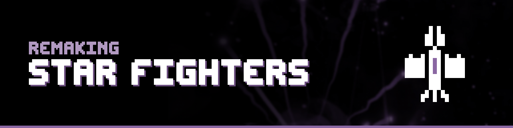

# Remaking Star Fighters

The code for **Remaking Star Fighters**, a code-along series on
[Bo Knows Games](https://www.youtube.com/@BoKnowsGames): a 32-player online space shooter, rebuilt
from scratch in Unreal Engine 5 and C++, one session at a time. The series runs in phases; Phases 0
to 2 are here.

Every session that changes the code has a **tag** in this repository holding the project exactly as
that session leaves it, so you can start from any session, check your work against it, or get back to a compiling state
after a typo twenty sessions ago.

## Using a session's code

- **Download it:** pick the session's tag on the [Tags](../../tags) page and download the zip.
- **Or check it out:** clone the repository, then `git checkout <tag>`, for example
  `git checkout 111-game-map`. Tags are fixed; `main` is the latest session.

Each session's video says which Unreal Engine version it uses (Phases 0 and 1: 5.5; Phase 2: 5.7).

### Before you open the project: the engine association

`StarFighters.uproject` names the engine it belongs to by an ID (`EngineAssociation`) that only
exists on the machine where the project was last opened: the author's engine, built from source.
On your machine, right-click `StarFighters.uproject` and choose **Switch Unreal Engine version…**,
then pick your engine (a source build, as session X01 shows, or an installed version). Don't commit
the changed ID back.

### Running the server and clients

After building the server and client targets in Visual Studio, `Run ALL Programs.bat` starts the
dedicated server and three clients on this PC (`Run SERVER with Log.bat` and
`Run CLIENT in Window.bat` start one at a time). `[PACKAGE] Run ALL Programs.bat` does the same for
packaged builds. The server address, window size and the packaged-build folder are settings at the
top of each file.

## Sessions

Session numbers are phase, part and session: 152 is Phase 1, Part 5, Session 2. Videos are added
to this table as they're published. Tips are set-up and workflow videos you can skip if you already
know the topic.

### Phase 0: Set-up, Planning & Preparation

| Session | Code | What you build | Video |
|---|---|---|---|
| 001 · Introduction to the Series |  | What this series builds, who it's for, and how it runs: a 32-player online space shooter, remade from scratch in Unreal Engine 5 and C++. |  |
| X01 · UE Source Install + UE version upgrade (tip) | [`x01-tip-ue-source-and-upgrade`](../../tree/x01-tip-ue-source-and-upgrade) | Install Unreal Engine from source through GitHub and Visual Studio, then see how to upgrade a project as new engine versions come out. |  |
| 011 · Project Set-up: Create a new C++ UE project (tip) | not tagged yet | Create the blank Unreal Engine 5 C++ project that every session in this series builds on. |  |
| 012 · Project Set-up: Version Control (tip) | [`012-tip-version-control`](../../tree/012-tip-version-control) | Put the project under git and connect it to a GitHub repository, so every session's work can be saved, tagged and restored. |  |

### Phase 1: Dedicated Server & Basic Online Gameplay

| Session | Code | What you build | Video |
|---|---|---|---|
| 100 · Phase Outline |  | A map of Phase 1: from an empty map to a dedicated server where connected players spawn ships, fly them, and shoot at each other. |  |
| 111 · Creating a New Game Map | [`111-game-map`](../../tree/111-game-map) | Start the server side: create the game map, give it a floor, lighting and a "server" sign, and make it the editor's default map. |  |
| 112 · Adding Stars to the Night Sky | [`112-night-sky-stars`](../../tree/112-night-sky-stars) | Write your first C++ class and turn it into a Blueprint that fills the sky with 500 stars, learning how C++ and Blueprint work together. |  |
| 113 · Server Creation and Packaging | [`113-server-packaging`](../../tree/113-server-packaging) | Set up build targets that split client from server, add the server's game mode, and package a server you can run on its own. |  |
| 114 · Logs and Command Line Arguments | [`114-logs-and-command-line`](../../tree/114-logs-and-command-line) | Print your first log messages in Unreal, and pass the server its name from the command line. |  |
| 115 · QoL tips #1 (tip) | [`115-tip-qol-1`](../../tree/115-tip-qol-1) | Speed up your workflow: when to package versus just compile, where builds live, and shortcuts that launch them in one click. |  |
| 116 · Creating a Blank Game Client | [`116-blank-client`](../../tree/116-blank-client) | Create a blank game client, connect it to the dedicated server, and set up a global library for shared values and functions. |  |
| 117 · Adding a Login Menu | [`117-login-menu`](../../tree/117-login-menu) | Build a login menu with widgets, calling C++ from Blueprint and back, with player name and server address set from the command line. |  |
| 118 · QoL tips #2 (tip) | [`118-tip-qol-2`](../../tree/118-tip-qol-2) | Launch the server and several clients with one batch file, each window in a fixed spot, plus sound alerts for Visual Studio builds. |  |
| 119 · Completing the Login Flow | [`119-login-flow`](../../tree/119-login-flow) | Finish the login flow: sync the player's name to the server and send back a welcome message, learning PlayerState, OnRep and RPCs. |  |
| 121 · Create the Pawn (= Ship) | [`121-creating-the-pawn`](../../tree/121-creating-the-pawn) | Create the ship: a C++ pawn and Blueprint with a model, collision and a name-and-ID label, with built-in movement replication off. |  |
| 122 · Setting up Enhanced Inputs | [`122-enhanced-input`](../../tree/122-enhanced-input) | Learn Unreal's Enhanced Input system and set up the game's first input mapping contexts and actions. |  |
| 123 · Spawning the Pawn | [`123-spawning-the-pawn`](../../tree/123-spawning-the-pawn) | Spawn the player's ship on demand and have their player controller possess it. |  |
| 124 · Initializing the Pawn | [`124-initializing-the-pawn`](../../tree/124-initializing-the-pawn) | Initialize each new ship and sync its name and ID to every client with your own OnRep functions, then update its label. |  |
| 131 · Setting up Gameplay Inputs | [`131-gameplay-inputs`](../../tree/131-gameplay-inputs) | Create every gameplay input for keyboard and gamepad, hook them to the player controller, and handle 2D inputs with axis swizzling. |  |
| 132 · Basic Controls (Moving - Overview + Set-up) | [`132-movement-setup`](../../tree/132-movement-setup) | Map the movement flow from player to server to clients, then capture input and send it to the server on a regular update. |  |
| 133 · Basic Controls (Moving - Implement + Sync) | [`133-movement-sync`](../../tree/133-movement-sync) | Move the ship on the server by applying physics force, then broadcast its location to every client with a multicast RPC. |  |
| 134 · Basic Controls (Moving - POLISH) | [`134-movement-polish`](../../tree/134-movement-polish) | Polish movement: broadcast velocity and rotation too, tune damping, and settle how often each ship sends updates. |  |
| 135 · Basic Controls (Turning / Aiming) | [`135-turning`](../../tree/135-turning) | Turn the ship from player input, handle its angular momentum, and convert angles into rotations. |  |
| 136 · Basic Controls (Turning - POLISH) | [`136-turning-polish`](../../tree/136-turning-polish) | Fix the motion-blur glitch: set a target heading with each network update, then turn the ship toward it smoothly in between. |  |
| 141 · Setting Up the Camera | [`141-camera`](../../tree/141-camera) | Create a camera that follows your ship around the map: a simple base to make more dynamic in later phases. |  |
| 151 · Shooting Projectiles | [`151-shooting-projectiles`](../../tree/151-shooting-projectiles) | Create your first projectile, with its physics, model and collision settings, then spawn it when the ship shoots and send it flying. |  |
| 152 · Projectiles: Collision Detection | [`152-collision-detection`](../../tree/152-collision-detection) | Learn the difference between hits and overlaps, then give the projectile a collider that reports when it touches something. |  |
| 153 · Projectiles: Collision Handling | none (the intermediate snapshot for this session was not captured; 154 contains its changes) | Work out what a projectile touched and who owns it, by stamping every projectile with its shooter's player ID. |  |
| 154 · Projectiles: Processing Hits | [`154-processing-hits`](../../tree/154-processing-hits) | Turn valid hits into real hits: tell every client, show an animated hit effect, and remove the projectile on impact or out of bounds. |  |
| 1XX · Phase Summary |  | A recap of Phase 1: what you built, how the pieces connect, and what Phase 2 adds next. |  |

### Phase 2: Advanced Gameplay

| Session | Code | What you build | Video |
|---|---|---|---|
| 200 · Phase Outline |  | A map of Phase 2: gamepad and mouse controls, health and damage, basic graphics, and a full weapon system with rockets and missiles. |  |
| 211 · Advanced Controls (Gamepad) | [`211-gamepad-controls`](../../tree/211-gamepad-controls) | Rebuild the controls around direction: a custom input struct sent to the server, direction-based moving and aiming, and twin-stick gamepad support. |  |
| 212 · Debug Display | [`212-debug-display`](../../tree/212-debug-display) | Draw debug displays that show the move and aim headings on screen, as numbers and as lines, using Unreal's debug draw helpers. |  |
| 213 · Advanced Controls (Mouse) | [`213-mouse-controls`](../../tree/213-mouse-controls) | Aim with the mouse: trace the cursor onto the gameplay plane through a custom collision channel, and turn the ship to face it. |  |
| 221 · Gameplay Attributes (Set-up) | [`221-attributes-component`](../../tree/221-attributes-component) | Start gameplay attributes: create an actor component, attach it to the ship, and route projectile hits into its damage processing. |  |
| 222 · Gameplay Attributes (Damage Processing) | [`222-damage-processing`](../../tree/222-damage-processing) | Do the damage math: ships lose health, every ship shows its health, and hits give visual feedback. |  |
| 223 · Gameplay Attributes (Death Processing) | [`223-death-processing`](../../tree/223-death-processing) | Make ships die: at zero health the controller lets go, and the ship plays its death effect and destroys itself on every client. |  |
| 224 · Gameplay Attributes (Return to Spectating) | [`224-back-to-spectating`](../../tree/224-back-to-spectating) | Send a destroyed player back to spectating, resetting their controls and camera so they can spawn again. |  |
| 231 · Basic Graphics (Materials and Models) | [`231-materials-and-models`](../../tree/231-materials-and-models) | Create basic materials for four surface types, color variants through material instances, and use them to brighten up the game. |  |
| 232 · Basic Graphics (In-Game UI Overlay) | [`232-ui-overlay`](../../tree/232-ui-overlay) | Build an in-game UI overlay and feed it information that starts on the server and passes through the client. |  |
| 233 · Basic Graphics (System Message Log) | [`233-system-message-log`](../../tree/233-system-message-log) | Add a system message log to the overlay: a scroll box of animated messages for joining the game, new ships and destroyed ships. |  |
| 241 · Weapons System (Adding the Weapon Class) | [`241-weapon-class`](../../tree/241-weapon-class) | Move shooting into its own weapon actor that the ship spawns and carries, and route input from player to ship to weapon. |  |
| 242 · Weapons System (Advanced Firing Mechanisms) | [`242-firing-mechanisms`](../../tree/242-firing-mechanisms) | Turn the weapon into a tunable machine gun: automatic fire while the trigger is held, cooldowns between shots, and recharging ammo. |  |
| 243 · Weapons System (Client-side UI) | [`243-client-side-ui`](../../tree/243-client-side-ui) | Show cooldowns and charges on the shooter's screen, by setting up network ownership from controller to ship to weapon. |  |
| 244 · Weapons System (Dual-Barrel Shooting) | [`244-dual-barrel`](../../tree/244-dual-barrel) | Add weapon barrels with models and muzzles, mount them on the ship, and fire from them: one barrel, or two that alternate. |  |
| 245 · Weapons System (EndPlay Clean-up) | [`245-endplay-cleanup`](../../tree/245-endplay-cleanup) | Clean up weapons, barrels and loose pointers when a ship leaves play, using EndPlay and the actor lifecycle. |  |
| 246 · Weapons System (The Second Weapon) | [`246-second-weapon`](../../tree/246-second-weapon) | Give each ship a second weapon with its own input, mounts, spawning, cooldown display and clean-up, fired independently. |  |
| 247 · Weapons System (Weapon Select - Part 1/2) | [`247-weapon-select-prep`](../../tree/247-weapon-select-prep) | Prepare for weapon select: hand weapon choice to the player controller, and add a blank weapon for an empty slot using a child class. |  |
| 248 · Weapons System (Weapon Select - Part 2/2) | [`248-weapon-select-ui`](../../tree/248-weapon-select-ui) | Finish weapon select: an enum shared by C++ and the UI, a menu to choose both weapons, and a ship that spawns with them. |  |
| 248E · BUGFIX: Zombie Ships | [`248e-bugfix-zombie-ships`](../../tree/248e-bugfix-zombie-ships) | Fix the "zombie ship" bug: a ship that spawns into a live projectile gets stuck between alive and dead. |  |
| 251 · Explosions | none (the intermediate snapshot for this session was not captured; 252 contains its changes) | Build an explosion system: area damage that falls off from the blast's core, a physics push, and effects on every client. |  |
| 252 · Shooting Rockets (Rocket 1/3) | [`252-shooting-rockets`](../../tree/252-shooting-rockets) | Fire rockets: thrust-driven projectiles that explode, with regular corrections that keep every client in sync. |  |
| 253 · Destroying Rockets (Rocket 2/3) | [`253-destroying-rockets`](../../tree/253-destroying-rockets) | Make rockets destructible: shots and explosions can damage them and blow them up mid-flight. |  |
| 254 · Synchronizing Rockets (Rocket 3/3) | [`254-syncing-rockets`](../../tree/254-syncing-rockets) | Keep rockets in sync across the network, so every player sees them in the same place. |  |
| 255 · Homing Missiles - Scan Mode | [`255-homing-scan-mode`](../../tree/255-homing-scan-mode) | Start homing missiles: the scan mode that finds a valid target to lock onto, decided by the server. |  |
| 256 · Homing Missiles - Chase Mode | [`256-homing-chase-mode`](../../tree/256-homing-chase-mode) | Finish homing missiles: chase a locked target, track it, and drop the lock when the target is lost. |  |
| 256E · BUGFIX: Better Synchronization | not tagged yet | Fix how homing missiles switch between scanning and chasing, so the change stays in sync for every player. |  |
| 2XX · Phase Summary |  | A recap of Phase 2: the controls, combat and weapon systems you built, and what Phase 3 adds next. |  |

### Tips you can watch any time

| Session | Code | What you build | Video |
|---|---|---|---|
| X02 · Splash Screen |  | Replace Unreal's default splash screen with your own image when the game starts up. |  |

Two sessions have no tag of their own: their intermediate snapshot wasn't captured, and the next
session's tag contains their changes (153 → 154, 251 → 252).

## License

The code is released under the [MIT License](LICENSE), which covers every branch and tag of this
repository, including those created before the license file was added. Assets in `Content/` that
come from Epic Games' templates or Starter Content remain subject to the
[Unreal Engine EULA](https://www.unrealengine.com/eula).

## Support the channel

Star this repository, subscribe to [Bo Knows Games](https://www.youtube.com/@BoKnowsGames?sub_confirmation=1),
and share the series with someone learning Unreal Engine.

More at [orakga.net](https://orakga.net).
